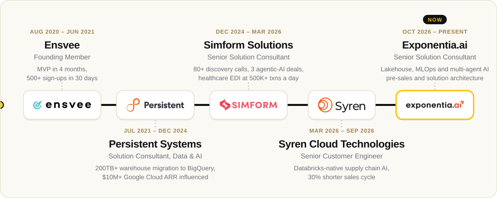

 

&nbsp;&nbsp;&nbsp;

## About

Presales Solution Architect with **6+ years** across pre-sales, data platform engineering, and applied AI on **Databricks, GCP, Azure, and AWS**. I turn enterprise requirements into measurable architectures across lakehouse, MLOps, real-time pipelines, and multi-agent AI, cutting cost, sales cycles, and time-to-value for F500 clients in CPG, BFSI, Healthcare, and Retail.

Right now I'm a Senior Solution Consultant at **Exponentia.ai** in Mumbai, owning technical discovery, solution architecture, and PoC scoping for enterprise Data & AI.

## Impact at a glance

## Career timeline

Text version

| When | Where | Role | Highlights |
| --- | --- | --- | --- |
| Oct 2026 – Present | **Exponentia.ai** · Mumbai | Senior Solution Consultant | Technical discovery, solution architecture, and PoC scoping for enterprise Data & AI; governed lakehouse, MLOps, and multi-agent AI architectures with TCO/ROI models. |
| Mar 2026 – Sep 2026 | **Syren Cloud Technologies** · Hyderabad | Senior Customer Engineer | Databricks-native supply chain AI pre-sales and a multi-agent PoC; 30% shorter average sales cycle. |
| Dec 2024 – Mar 2026 | **Simform Solutions** · Ahmedabad | Senior Solution Consultant | 80+ discovery calls across the US, Canada, and EMEA; 3 production agentic-AI deals; healthcare EDI platform at 500K+ daily transactions. |
| Jul 2021 – Dec 2024 | **Persistent Systems** · Gurugram | Solution Consultant, Data & AI | 200TB+ warehouse migration to BigQuery; multi-agent document-intelligence PoC in 6 weeks; $10M+ in Google Cloud ARR influenced; production GCP infrastructure and demo accelerators. |
| Aug 2020 – Jun 2021 | **Ensvee** · Delhi | Founding Member | Product, business model, and go-to-market; MVP in 4 months and 500+ sign-ups in the first 30 days. |

## How I work

- **Architect** cloud-native lakehouse, streaming, governance, and ML platforms across GCP, Azure, AWS, and Databricks.
- **Build** production-oriented AI systems, from predictive ML and MLOps to RAG and multi-agent workflows with clear tool contracts and evaluation loops.
- **Translate** ambiguous requirements into demos, reference architectures, PoCs, and value cases that technical and executive stakeholders can act on.

## Featured work

Every demo below is live; no sign-in needed. Pick a role and click around.

| Project | What it demonstrates | Stack |
| --- | --- | --- |
| **Portfolio** [Live site ↗](https://vineetkumar-portfolio.vercel.app/) | Case studies with their architecture left in (HLD, LLD, sequence, state, and data-model diagrams) and a guarded AI assistant grounded on one verified profile. | React · TypeScript · Vite · FastAPI · Pydantic AI · Cloud Run |
| **Agentic Motor Claims Platform** [Live demo ↗](https://agentic-claims-nu.vercel.app) · [Code](https://github.com/earthlydope/agentic-claims) | Eleven agents on a LangGraph orchestration, grounded on a governed semantic layer with zero-trust controls: automation recommends, deterministic services decide, people approve. | Python · LangGraph · Gemini |
| **Supply Chain Resilience Command Center** [Live demo ↗](https://scr-resilience-command-center.vercel.app) · [Code](https://github.com/earthlydope/scr-resilience-command-center) | A persona-driven resilience intelligence demo for CPG: digital-twin what-ifs, disruption simulation, and an agentic AI copilot, on synthetic data that reconciles across every page. | JavaScript · ECharts |
| **Supplier Risk Sensing** [Live demo ↗](https://srs-supplier-risk-sensing.vercel.app) | An agentic supply-risk command center: live event sensing, revenue exposure, supplier and material risk, AI-proposed mitigations, and what-if simulation, with a mobile and a web view per role. | JavaScript · ECharts |
| **Retail 360** [Live demo ↗](https://rct-portal-replica.vercel.app) | A retail analytics dashboard with AI-powered insights over customer data. | Next.js · Recharts · Databricks · Claude |
| **Databricks Genie Ontology skill** [Code ↗](https://github.com/earthlydope/databricks-genie-ontology-skill) | A skill for AI coding agents that builds, verifies, and hardens a governed Genie ontology foundation on Databricks: Unity Catalog tables, certified metric views, and a Genie agent, with 11 industry packs. | Python · Databricks · Unity Catalog · Claude Code |

## Toolbox

## Certifications

- **Google Cloud:** Cloud Digital Leader, Associate Cloud Engineer, Professional Data Engineer, Professional Cloud Architect, Professional Machine Learning Engineer
- **Databricks:** Certified Data Engineer Associate

## Current focus

- Designing governed lakehouse, MLOps, and multi-agent AI architectures with clear tool contracts and evaluation loops
- Connecting AI use cases to operational KPIs, ROI, and adoption
- Building governed, production-ready data foundations for enterprise AI

[Portfolio](https://vineetkumar-portfolio.vercel.app/) · [LinkedIn](https://www.linkedin.com/in/vineetsolutionconsultant/) · [Repositories](https://github.com/earthlydope?tab=repositories)

